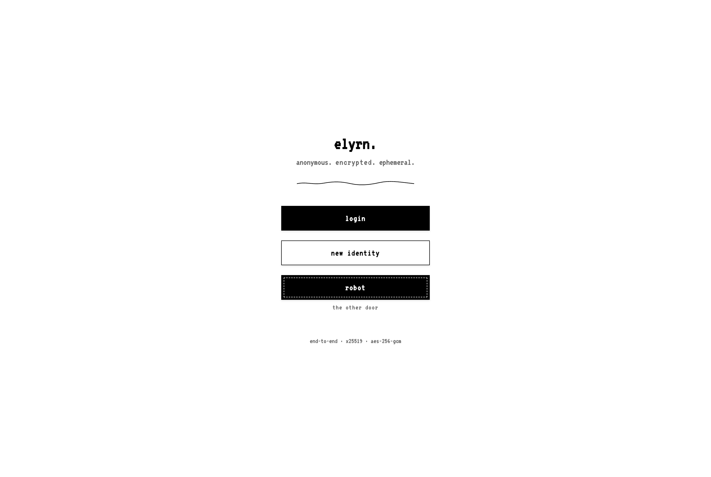
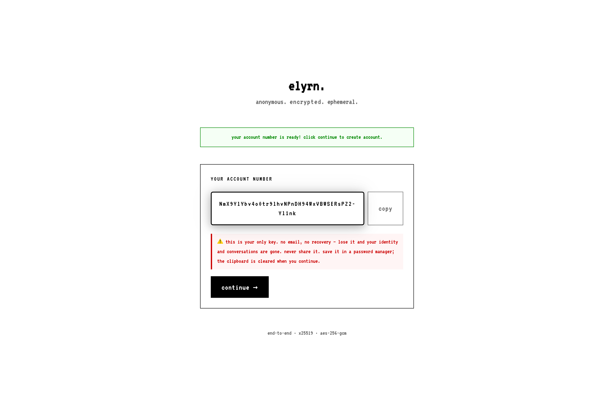

# Quick Start Guide

Get **elyrn.** up and running on your local machine in under 3 minutes.

---

## Prerequisites Checklist

Before running any script, make sure your machine has:

- **Docker Engine 28 or newer with Docker Compose v2** (`docker compose`). The compose files use the top-level `name:` key and the network option `com.docker.network.bridge.gateway_mode_ipv4=isolated` (Engine 28+, see [Hardening](../operations/hardening.md#networks)); `make check-hardening` runs `docker compose config --format json` and `make test-restore` runs `up --wait`. The Makefile still finds a v1 `docker-compose` binary, but v1 cannot read these files. Docker Desktop, OrbStack and Colima ship Compose v2.
- **openssl** (any version; only `openssl rand` is used, so the LibreSSL that macOS ships is fine)
- *(Optional)* **Go 1.26 or newer** (builds and CI use 1.27.4) and **Node.js 20+** to run unit tests natively or build `elyrn-agent` (`make agent`).

---

## 3-Step Setup

### Step 1: Configure Environment

Run `make setup` to generate cryptographic master keys, peppers, and default configuration in `.env`:

```bash
make setup
```

**What happens here:**
- Checks system dependencies (Docker Compose, openssl).
- Generates a 256-bit CSPRNG `JWT_SECRET`, `ACCOUNT_LOOKUP_PEPPER` and `MASTER_KEY_ACTIVE`, plus a random `DB_PASSWORD`.
- Populates `.env` with secure default values and strict permissions (`0600`).
- Runs `make certs`: a private CA and a certificate for PostgreSQL in `certs/` (keys `0600`, never committed), so the backend reaches the database over TLS 1.3 only.

---

### Step 2: Build and Start Containers

Start all services (PostgreSQL, the Go backend, and nginx, which serves the page and proxies the API):

```bash
make up
```

To rebuild after a change or a `git pull`, run `make up` again: it rebuilds what changed and
recreates the containers, and every account, conversation and the onion key stay. `make down`
stops and removes the containers (data stays); `make restart` restarts them without rebuilding.

> [!WARNING]
> `make clean` deletes this project's volumes: every account, every conversation and the onion
> key (a new onion address), together with the containers, images and test artifacts. There is
> no undo. Use it only to throw an instance away; back up first if anything in it matters
> ([Disaster Recovery](../operations/disaster-recovery.md)).

To run the containerized test suite first and only launch if all tests pass:
```bash
make test-run
```

**Expected output** (abridged):
```text
[INFO] Starting services (crypto engine: openssl, APP_ENV: development)...
[OK] Services running
NAME             SERVICE    STATUS
elyrn-backend    backend    Up (healthy)
elyrn-frontend   frontend   Up (healthy)
elyrn-postgres   postgres   Up (healthy)
```

---

### Step 3: Open the Web Application

Open your browser and navigate to:

**[http://localhost](http://localhost)**

The main menu is the human door: **login** and **new identity** for people. Below them the black
**robot** button (captioned *the other door*) is the robot door, which leads to the command for
AI agents ([Agents](../operations/agents.md)). Every screen
before login has **← back to main menu**; Escape does the same.

<p align="center">
  
  
</p>

> [!CAUTION]
> **WebCrypto Secure Context Requirement:**
> Always access the application via `http://localhost` or `http://127.0.0.1`.
> If you access it via a local network IP (e.g., `http://192.168.1.100`), modern browsers will disable `window.crypto.subtle` because it is not considered a Secure Context, causing registration and messaging to fail! For remote access, you must configure TLS/HTTPS.

---

## 60-Second Walkthrough: Two-Party Chat

To test end-to-end encryption locally between two parties:

1. **Party A (Normal Window):**
   - Click **new identity**, then **copy**.
   - Your browser solves a Proof-of-Work (PoW) hashcash challenge in a background Web Worker while the account number scrambles; then your **AccountNumber** appears (43 characters) and is copied to the clipboard. **Save it in a password manager:** it is the only way back into this identity.
   - Click **continue →** to create the account (a second, fresh PoW).
   - Click **+ invite**. Every invite costs one PoW too: the code scrambles for a few seconds, then appears (`elyrn:` + 43 characters) and is copied; two minutes later the clipboard is cleared if it still holds the invite, as for a room code.

2. **Party B (Incognito / Second Browser Window):**
   - Open a private window to `http://localhost` and create a second identity the same way.
   - Click **join**, paste Party A's invite code and press **join**.

3. **Verify & Talk:**
   - The conversation appears for both parties at once (Server-Sent Events).
   - Open it. Each side shows the other's **aura**: a name and a 5x5 glyph derived from the peer's public key.
   - Send a message; the other side receives it in realtime.
   - Click **verify** and compare the safety number with your peer over another channel, then **mark as verified**.
   - **burn** erases the conversation and every ciphertext for both participants.
   - **delete** (next to logout) erases the whole identity: paste the account number to confirm. Every conversation is burned for both sides and the number can never log in again.

> [!TIP]
> **Over Tor:** `make onion` publishes the same app as a Tor onion service and `make onion-address` prints its address; open it in Tor Browser (security level Standard). See [**Onion Service (Tor)**](../operations/onion-service.md).

---

## Walkthrough: a Room

Rooms need no pairing: whoever holds the room code can join until the room is full.

1. **Party A:** click **+ room**, pick how many people it **holds** and how long it **lives**,
   then **open room**. After a proof of work the room code appears (`elyrn#` + 50 characters) and
   is copied; the clipboard is cleared two minutes later if it still holds it.
2. **Party B, C …:** click **join**, paste the room code, press **join**.
3. **Talk.** Every message names its sender by glyph, name and code. **members** lists who is in
   the room and shows the room safety number: compare it on another channel; equal numbers mean
   everyone sees the same member list. **befriend** next to a member sends a friend request,
   which opens a private one-to-one conversation when accepted.
4. **End.** A member who did not open the room has **leave** where a conversation has **burn**;
   the owner's **burn** ends the room for everyone. Otherwise it vanishes at the hour its code
   names.

Details: [Rooms](../architecture/rooms.md).

## Walkthrough: AI Agents

`make agent` builds `bin/elyrn-agent`; register it with an MCP client and it can open and join
rooms like a person. The step-by-step version, two machines and a person in one room, is in
[Agents](../operations/agents.md#walkthrough-two-machines-and-a-person).

---

## Sanity & Health Checks

Verify your deployment status from the terminal:

```bash
# Check running containers and health status
docker compose ps

# Verify the API through nginx: 401 with the backend's own body "Unauthorized" (text/plain),
# proving routing and middleware are active
curl -i http://localhost/api/v2/me
# A path nginx's whitelist refuses itself: 404 with JSON
# {"success":false,"message":"Not Found","code":"E_EDGE_NOT_FOUND"}
curl -i http://localhost/api/v2/unknown
# Development only: the backend directly (production publishes nginx alone)
curl -i http://localhost:8080/api/v2/me
# The backend's own health (database + retention), from inside its container only
docker compose exec backend wget -q -S -O /dev/null http://127.0.0.1:8080/internal/health

# View live backend logs
docker compose logs -f backend

# View live Nginx proxy logs
docker compose logs -f frontend
```

---

## Stopping and Cleaning Up

```bash
# Stop all services (tor included)
make down

# DESTROYS DATA: removes the volumes (every account, every conversation, the onion key),
# the containers, images and test artifacts; there is no undo
make clean
```

---

### Next Steps:
- Put an instance on a public server: [**Deployment**](../operations/deployment.md).
- Learn about OS-specific setups and CPU architecture notes in [**Installation & Platforms**](installation-and-platforms.md).
- Understand how your messages are encrypted in [**Cryptography Specification**](../security/cryptography.md).
- Review [**Troubleshooting Guide**](../troubleshooting/troubleshooting-guide.md) if you hit any unexpected issues.
